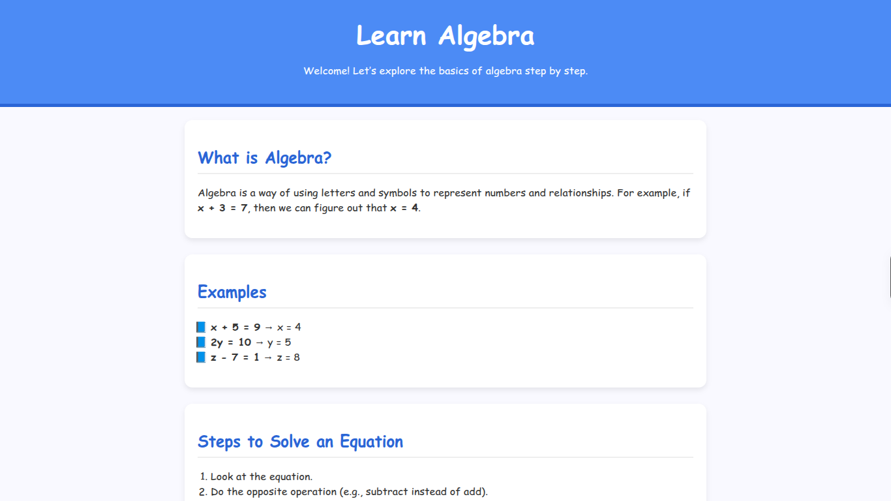
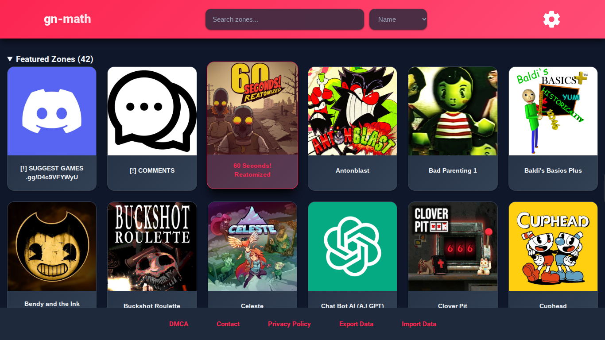
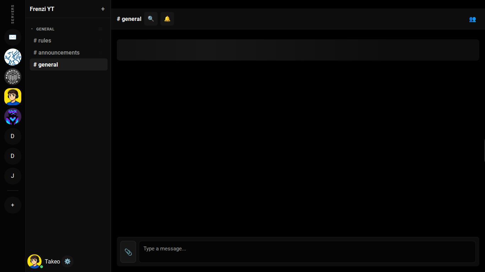
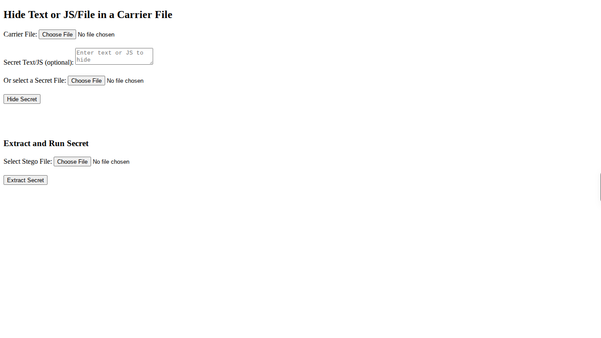

# Let's Learn Algebra


LLA is a masked g*me site, along with a full realtime chat, kind of like Discord. 



# Hosting Instructions
To host this, run the following commands:
```sh
git clone https://github.com/c3p0r2d2luke/lla
cd lla
```
The site can be served statically (with the exception of things inside of `s/chat/`)
# Folders & Navigation
From the base index.html, you have some optional shortcuts to use:
```
ctrl + alt + C: The chat
shift + X: G*mes
```
If you want to go to the folders without shortcuts, here's a cheat sheet:

`s/`: The secret folder, that contains all of the g*mes, chat, etc.

`s/schoolwork/`: The g*mes. Basically just a clond of GN-Math



`s/chat/`: The chat. Needs to be built and run seperatly. (Follow the instructions of `s/chat/README.md`)



`s/blog/`: This is the changelog of LLA. Optional to setup, and IDK if it will actually let you set it up.

`s/cloud/`: Clone of CloudMoon GitHub repo.

`s/other/`: Other stuff I maintain. (JS-DOS, APK Runner, File downloader, Stegonography kit, etc.)



# About `bot/`
`bot/` contains the legal information about my discord bot that you need to add to servers if you want to access your servers from the LLA chat.

# AI Usage Declaration
As of `Nov. 3, 2026`, I have used AI to make the chat. It also helped make `index.html` and `s/chat/README.md`. If you find any problems, please feel free to submit an issue or a pull request, and I will get around to that. As of this date, no more AI shall be used in the making of this project.